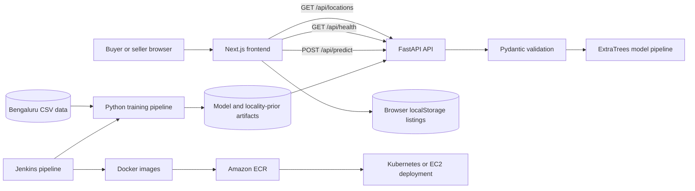
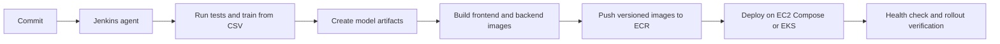

# Bengaluru Nest AI — Project Guide and Interview Preparation

> A detailed walkthrough of the application, model, API, CI/CD pipeline, AWS deployment options, current limitations, and interview answers.
>
> **Status snapshot:** 1 November 2026. AWS account offers and prices can change; confirm the current terms in the AWS Billing console before deploying.

## 1. Project summary

Bengaluru Nest AI is a property price estimation and seller listing application for Bengaluru. A buyer enters a locality, built-up area, bedroom count, and bathroom count to get an estimated price in lakhs. A seller can enter property details, see an estimate while filling the form, compare an asking price with the estimate, and publish a listing. The listings board supports location, BHK, and budget filters.

The application has four main parts:

1. **Next.js frontend** — renders the user interface, forms, estimate results, and listings.
2. **FastAPI backend** — validates requests, loads the trained model, and returns price estimates.
3. **Python model training pipeline** — cleans Bengaluru housing data, engineers locality features, evaluates a fixed holdout set, and writes model artifacts.
4. **Docker and deployment configuration** — runs the services locally and describes Kubernetes deployments. Jenkins automates model training, checks, image builds, registry pushes, and deployment commands.

The model is a decision-support estimate. Its R² is a goodness-of-fit statistic, not a claim that every valuation is accurate by that percentage. The actual holdout MAE is about ₹23.7 lakh, so users should treat a single estimate as a broad guide.

## 2. Changes made in this version

- Replaced the old single-number locality frequency input with one-hot locality categories and locality median price and price-per-square-foot features.
- Cross-fitted the locality priors during training. Each training row is excluded from the locality statistics used to build that row's features, reducing target leakage.
- Selected a compact ExtraTrees model with 100 trees. On the fixed random 20% holdout, it achieved **R² 0.8005**, **MAE ₹23.6960 lakh**, and **RMSE ₹55.3272 lakh**. The previous tracked metrics reported R² 0.5987, MAE ₹31.7224 lakh, and RMSE ₹78.4695 lakh.
- Added a training gate that refuses to publish model artifacts if holdout R² is below 0.75.
- Refitted the deployable model on all 12,372 cleaned rows after measuring holdout performance.
- Compressed the model artifact with joblib. The current model artifact is about 20 MB instead of roughly 345 MB uncompressed.
- Updated the API to build the new locality-aware feature row and load compressed joblib artifacts.
- Added `pandas` to API dependencies because the model pipeline consumes named feature columns.
- Reworked README and Jenkins dependency setup, added an early Docker artifact check, and removed the Kubernetes model PVC mount. The backend image now carries the trained artifacts itself.
- Replaced browser `alert()` validation with inline seller form errors and publishing feedback, made the location selector use keyboard-operable buttons, and renamed the UI statistic from “Model Accuracy” to “Model Score (R²)”.

## 3. Architecture and request flow



### Local development flow

`docker-compose.yml` starts the frontend on port 3000 and backend on port 8000. The backend container needs generated model files under `server/model/`; run training before building it. The frontend's current API client defaults to `http://localhost:8000`, which works for a browser on the same computer during local development.

`nginx/nginx.conf` describes a reverse proxy for frontend and API routes, but the current Compose and Kubernetes manifests do not deploy an Nginx container. Treat it as a configuration sample until it is wired into a deployment.

## 4. Frontend details

**Technologies:** Next.js App Router, React, TypeScript, CSS Modules, and Tailwind/PostCSS tooling. React owns the interactive form and page state; CSS Modules style the page and components.

**Main files:**

- `frontend/src/app/page.tsx` — page state, predictor and seller flows, listings filters, and the result panels.
- `frontend/src/utils/predictor.ts` — typed HTTP client for the backend.
- `frontend/src/utils/listings.ts` — listing type, browser storage, and asking-price comparison helper.
- `frontend/src/components/CustomDropdown.tsx` — searchable locality selector.
- `frontend/src/components/ListingCard.tsx` — property card and contact reveal.

### Buyer estimate

1. The page loads available localities with `GET /api/locations` and model metadata with `GET /api/health`.
2. The buyer chooses a locality and property size/configuration.
3. The form sends a JSON `POST /api/predict` request.
4. The page displays the predicted price and the API's confidence range.

### Seller listing

The seller form debounces estimate requests while the seller changes property features. On submit, the browser obtains a valuation, creates a listing object, and stores it in `localStorage`. The listing is then shown in that browser's listings board. Starter/example listings are also defined in the frontend.

**Current storage limitation:** localStorage is per browser. A listing does not automatically appear on another user's device, and clearing browser storage removes the user's listings. There is no listings database or listings API in the current backend.

## 5. Backend and API details

**Technologies:** Python 3.11, FastAPI, Pydantic 2, NumPy, pandas, scikit-learn, and joblib. Uvicorn runs the ASGI application.

The backend loads the model, locality priors, and metrics during application startup. It keeps them in process memory so each prediction does not reload model files. The Docker image checks at build time that the model, encoder, and metrics files exist.

### Endpoints

| Endpoint | Purpose | Main behavior |
| --- | --- | --- |
| `GET /` | Service identification | Returns API name, version, and documentation path. |
| `GET /api/health` | Readiness and model metadata | Returns status, model name, dataset size, and held-out R². |
| `GET /api/locations` | Frontend locality options | Returns sorted locality names from the saved top-locality map. |
| `POST /api/predict` | Price prediction | Validates property inputs and returns price in lakhs plus a confidence range. |
| `GET /api/metrics` | Process counters | Returns predictions, average latency, and error counters since this process started. |

### `POST /api/predict` request and response

Request:

```json
{
  "location": "whitefield",
  "sqft": 1200,
  "bhk": 2,
  "bath": 2
}
```

Response shape:

```json
{
  "predicted_price": 46.82,
  "currency": "Lakhs",
  "confidence_range": [43.07, 50.57]
}
```

The exact response values vary with the trained artifact. Pydantic rejects blank locations and nonpositive square footage, and constrains BHK and bathroom values. Unknown localities fall back to the saved `other` locality priors and to an unknown one-hot category the estimator can ignore.

### Current API considerations

- CORS currently permits all origins. Restrict it to the deployed frontend origin before exposing the API publicly.
- The confidence range is currently a fixed ±8% band. It is not calibrated from residuals and should not be described as a statistically guaranteed interval.
- Runtime counters are in-memory and reset when the process restarts. With multiple replicas, each replica has separate counters.
- Seller listing writes do not go through this API; they remain browser-local.

## 6. Model training, evaluation, and selection

### Dataset and cleaning

The current training dataset is `model_training/Bengaluru_House_Data.csv` with 13,320 raw rows. The cleaning pipeline:

1. Finds CSV datasets in `model_training/` and maps common column names to `location`, `sqft`, `bhk`, `bath`, and `price`.
2. Parses square-footage ranges and numeric bedroom counts.
3. Drops rows without price or area and median-imputes missing BHK/bath values.
4. Normalizes locality names to lowercase.
5. Removes entries with less than 300 square feet per BHK.
6. Filters extreme locality-level price-per-square-foot values using a three-standard-deviation rule.
7. Removes rows where bathrooms exceed BHK by more than two.

This produced **12,372 cleaned rows** for the current run. Raw data and generated cleaned CSV files are ignored by Git. The training machine or Jenkins agent must receive the CSV separately; the repository alone does not contain it.

### Feature design

The model uses:

- One-hot encoded locality category, grouped for categories with fewer than five observations.
- `sqft`, `bhk`, and `bath`.
- `sqft_per_bhk`, a useful proxy for property size per bedroom.
- Training-derived median locality price and median locality price per square foot.

The previous model encoded a locality as one frequency value. That feature tells the model how common a locality is, but not which locality it is. One-hot categories retain locality identity, and the robust median priors provide direct neighborhood price context.

Locality price statistics are target-derived, so computing them from the same row being predicted would leak target information. Training cross-fits those statistics over five folds: each training fold gets priors calculated from the other folds. The holdout priors use only the training split.

### Model choice and reasons

The selected estimator is **ExtraTreesRegressor** with 100 trees, minimum leaf size 2, all candidate features considered at each split, and a fixed random seed. The estimator is wrapped in a scikit-learn `Pipeline` with a `ColumnTransformer` and `OneHotEncoder`.

Reasons for this choice:

- Housing prices have nonlinear relationships with area, rooms, and locality; tree ensembles model these interactions without requiring a linear formula.
- ExtraTrees adds randomness to split selection, which can reduce variance and makes it efficient to train many decorrelated trees.
- It performs well on this tabular dataset and held out 20% test split.
- One hundred trees produced nearly the same R² as a 500-tree experiment (about 0.8005 versus 0.8008), with a much smaller artifact. The compressed model is about 20 MB.
- The model uses a scikit-learn pipeline, so the categorical transformation is saved with the estimator and applied consistently during inference.

The pipeline measures a fixed 80/20 `train_test_split` with `random_state=42`, reports metrics on that untouched holdout, then refits the deployable model on all rows using cross-fitted priors. Training stops before writing artifacts if the holdout R² is below 0.75.

| Metric | Current result | Interpretation |
| --- | ---: | --- |
| R² | 0.8005 | The model explains about 80% of target variance on this fixed holdout. This is not “80% accuracy” for each home. |
| MAE | ₹23.6960 lakh | Mean absolute difference between prediction and transaction price on the holdout. |
| RMSE | ₹55.3272 lakh | Penalizes large errors more heavily; this is relatively high because a few expensive homes have large residuals. |

The old saved metric file reported R² 0.5987, MAE ₹31.7224 lakh, and RMSE ₹78.4695 lakh. Comparing the old and current fixed-split metrics shows a material improvement. Future evaluation should also test splits by time and by locality to estimate performance on unseen market periods or neighborhoods.

### Generated artifacts

- `server/model/home_price_model.pkl` — compressed joblib serialization of the trained scikit-learn pipeline.
- `server/model/location_encoder.pkl` — locality median-prior map and `other` fallback.
- `server/model/metrics.json` — copy of the metrics bundled with the backend image.
- `model_training/metrics.json` — checked-in current evaluation result.
- `model_training/data/cleaned.csv` — generated cleaned rows; ignored by Git.

To train locally, provide a source CSV and run `python model_training/pipeline.py`. The model build expects artifacts before the backend Docker image is built.

## 7. Docker, Jenkins, and Kubernetes

### Docker

- `frontend/Dockerfile` builds the Next.js app and runs `next start` on port 3000.
- `server/Dockerfile` installs the API dependencies, copies the server directory (including trained model artifacts), verifies required files, and starts Uvicorn on port 8000.
- `docker-compose.yml` starts both containers for local development.

### Jenkins stages

The current `Jenkinsfile` describes this sequence:

1. Install Python dependencies and frontend npm packages.
2. Run the model data pipeline tests.
3. Train the model and verify the artifacts exist.
4. Run FastAPI server tests.
5. Build frontend and backend Docker images.
6. Tag and push images to Amazon ECR.
7. Apply Kubernetes manifests and wait for rollouts.

The Jenkins agent must have a compatible Python runtime, Node/npm, Docker, AWS/ECR authentication, `kubectl`, a valid Kubernetes context, and access to the training CSV. This repository does not install Jenkins, create the cluster, configure its credentials, or upload the dataset.

### Kubernetes manifests

- `k8s/backend-deployment.yaml` runs the API and exposes it through a NodePort Service. It sets `MODEL_DIR=/app/model`, where the image's model artifacts live.
- `k8s/frontend-deployment.yaml` runs the frontend and exposes it through a NodePort Service.
- `k8s/hpa.yaml` configures backend CPU-based autoscaling from one to three replicas.

**Deployment prerequisites/gaps to resolve:** `Jenkinsfile` runs `kubectl apply -k k8s/`, but this checkout currently has no `k8s/kustomization.yaml`; add one listing the manifests before that stage can succeed. The image names also contain a specific ECR account/region and `latest` tag; configure the intended account, region, and immutable build tag. The frontend build currently defaults to `http://localhost:8000`, which points at the end user's computer in production. Set `NEXT_PUBLIC_API_BASE_URL` at frontend build time to a reachable API URL, or deploy a same-origin reverse proxy and use relative `/api` routes. The Nginx configuration exists but is not currently deployed. For a public service, put a load balancer/Ingress and TLS in front of the services rather than relying on manually opened NodePorts.

## 8. AWS deployment with a new six-month Free Tier account

### Current Free Tier terms

As checked on 1 November 2026, a new AWS customer can receive $100 in credits at signup and may earn up to another $100 through eligible activities. The Free account plan ends after six months or when credits are exhausted, whichever happens first; the Free plan then closes unless upgraded within AWS's stated period. Credits expire 12 months after account creation. These terms apply to eligible new customers and are not a promise that every service or every architecture is free. See [AWS Free Tier FAQs](https://aws.amazon.com/free/free-tier-faqs/), [AWS Free Tier terms](https://aws.amazon.com/free/terms/), and [AWS account plan documentation](https://docs.aws.amazon.com/awsaccountbilling/latest/aboutv2/free-tier-plans.html).

Amazon ECR currently advertises 500 MB/month of private repository storage for a new ECR customer for one year. The project's images and retained old tags count toward storage. See [Amazon ECR pricing](https://aws.amazon.com/ecr/pricing/).

Amazon EKS charges **$0.10 per cluster-hour** for a cluster on a standard-support Kubernetes version, before worker compute, EBS disks, public IPv4 addresses, load balancers, and data transfer. That control-plane fee alone is about $73 for a 730-hour month and about $438 over six months of continuous use. EKS therefore is **not a no-cost assumption** for this project; credits may offset eligible charges but the full architecture can exceed $200. See [Amazon EKS pricing](https://aws.amazon.com/eks/pricing/) and [EKS FAQs](https://aws.amazon.com/eks/faqs/).

The Free plan only provides access to eligible services and usage. Check the current account plan and service eligibility before attempting EKS. AWS lists Free Tier EC2 instance families and limits in its [EC2 Free Tier usage documentation](https://docs.aws.amazon.com/AWSEC2/latest/UserGuide/ec2-free-tier-usage.html). Free usage limits, credits, public IPs, storage, and data transfer are separate considerations; monitor them in Billing and set a budget alert.

### Recommended path for a six-month learning account

For a cost-conscious demonstration, run **Docker Compose on one eligible EC2 instance** rather than starting with EKS:

1. Create a new AWS account and choose the account plan intentionally. Review the credit balance, Free Tier usage page, and expiration dates.
2. Set a small AWS Budget and billing alerts before creating compute resources. Never treat credits as a spending cap on a Paid plan.
3. Choose an EC2 instance that the console marks eligible for the account and region. The app is small enough for a single-instance demo, but the chosen RAM must accommodate Node, Python, pandas, scikit-learn, and the model.
4. Install Docker on the instance and run the frontend and backend containers with Compose. For a small demo, publish only the intended web entry point; do not expose the backend unnecessarily.
5. Provide the API URL through the frontend build-time `NEXT_PUBLIC_API_BASE_URL` setting, or configure a reverse proxy for same-origin `/api` requests.
6. Keep the trained model files in the backend image. If training in Jenkins, make sure the Jenkins agent has the raw CSV, then train before building the backend image.
7. If using ECR, push commit-specific image tags and remove old images you no longer need to stay within storage limits.
8. Stop or terminate resources when not in use. Check EC2, EBS, public IPv4, ECR, load balancer, and data-transfer costs separately.
9. Before the six-month Free plan ends, export anything needed and deliberately decide whether to upgrade. Under the Free plan, AWS says access ends when the plan expires or credits are exhausted; do not assume the environment will remain available.

### EKS path for a portfolio or Kubernetes demonstration

Use EKS if Kubernetes is a core learning objective and you accept its costs. Create the cluster and worker capacity separately; this repository only contains workload manifests. Configure AWS IAM access for Jenkins, create/push ECR images, provide a Kustomize file, configure frontend API routing, and expose the public frontend through a load balancer or Ingress. Add TLS, domain/DNS, a suitable persistent data strategy if listings later move to a database, and resource requests/limits. Delete the cluster and associated EC2, EBS, load-balancer, and public-IP resources when finished.

### Cloud pipeline sequence



The current Jenkinsfile uses `latest` tags and deploys Kubernetes. A safer release process uses an immutable commit tag, confirms health/rollout, and keeps a previous known-good image tag for rollback. The AWS account, ECR repository, cluster/EC2 host, credentials, network routing, and dataset delivery are environment-specific inputs, not created by the current pipeline.

## 9. Strengths, trade-offs, and next steps

### Strengths

- Clear split between UI, API, model training, and deployment configuration.
- Typed frontend API client and Pydantic request validation.
- Model artifacts are loaded once and shared by the API process.
- The model is evaluated on a held-out split, errors are reported in Lakhs, and training enforces a minimum R² threshold.
- Locality priors are cross-fitted to reduce target leakage.
- Docker and Kubernetes files make the project a useful platform-engineering interview example.

### Known limitations

- Current listings are localStorage-only, not a shared marketplace.
- The confidence band is a fixed percentage, not a calibrated prediction interval.
- The random holdout can put homes from the same locality in both train and test. It estimates interpolation among familiar areas, not necessarily new-locality or future-market performance.
- The model uses a relatively small feature set and does not include property age, floor, builder, amenities, sale date, or geospatial context.
- CORS is permissive, and seller contact details are stored in browser listing records. Review privacy, access controls, and public API settings before a public launch.
- Metrics endpoint counters are process-local; no centralized observability or structured production alerting is configured.
- Jenkins assumes infrastructure and credentials exist; it does not provision AWS resources.
- Current Kubernetes apply command needs a Kustomize file, and cloud API routing must be configured before browser predictions work outside localhost.

### Sensible next improvements

1. Calibrate prediction intervals using a separate calibration set or conformal prediction and show limitations near unfamiliar areas.
2. Add time-based and locality-held-out evaluations, then track performance by price band and locality.
3. Add more predictive property and transaction features when reliable source data is available.
4. Move listings to a database-backed API with validation, moderation, and appropriate seller-consent/contact controls.
5. Add frontend production tests, API contract tests, model artifact versioning, structured logs, and deployment rollback.
6. Use immutable Docker tags, IaC for AWS infrastructure, secret management, and explicit cost controls.

## 10. Interview questions and candidate-style answers

### Basic questions

**Q: What does your project do?**

**A:** “It estimates residential property prices in Bengaluru from locality, square footage, BHK, and bathrooms. It also has a seller flow where the seller sees an estimate while entering a listing and can compare the asking price. The UI is Next.js, inference is served by FastAPI, and the model is trained separately in Python.”

**Q: Why did you split frontend and backend?**

**A:** “The frontend handles interaction and rendering, while the API owns request validation and model execution. That keeps model dependencies out of the browser, gives us a stable HTTP contract, and lets the API scale independently if traffic grows.”

**Q: What is an API in this application?**

**A:** “It is the HTTP boundary between the browser and the prediction service. The browser posts JSON to `/api/predict`; FastAPI validates it with Pydantic, builds the exact model feature frame, runs inference, and returns JSON with the estimate and range.”

**Q: What does R² 0.8005 mean?**

**A:** “On the fixed holdout, the model explains about 80% of the variance in observed prices relative to a mean-price baseline. It does not mean 80% of predictions are correct. I also report MAE, which is about ₹23.7 lakh, to express average absolute error in the product's price unit.”

**Q: Why are prices in Lakhs?**

**A:** “The source data and API use Lakhs as the model target unit, which keeps Bengaluru prices readable and matches the UI's Lakh/Crore formatting. The API labels the response currency unit so clients do not have to infer it.”

**Q: What is stored in localStorage?**

**A:** “User-created listing data for the current browser. It makes the demo usable without a database, but it is not shared between users or devices and is not suitable as production marketplace storage.”

### Frontend and API questions

**Q: Walk me through a prediction request.**

**A:** “The user submits locality, area, BHK, and bathroom values. `predictor.ts` sends a JSON POST. FastAPI validates types and bounds, normalizes the locality, reads the saved locality priors, creates a named pandas feature row, and calls the serialized scikit-learn pipeline. The API clamps the result to at least one Lakh and returns the predicted value and current range.”

**Q: Why use Pydantic?**

**A:** “It puts validation at the API boundary and returns a standard 422 response for malformed inputs. It also makes the endpoint schema visible in the generated OpenAPI documentation.”

**Q: How does the frontend work in production?**

**A:** “The browser needs a reachable API URL. The current default points to localhost, which is only correct when the browser and backend are on the same machine. For a cloud deployment I must set `NEXT_PUBLIC_API_BASE_URL` during the Next.js build or route `/api` through a same-origin reverse proxy.”

**Q: What does the health endpoint tell you?**

**A:** “It reports whether the model loaded and provides model version, dataset size, and holdout R². Kubernetes probes use it to decide whether the API is ready and alive. I would consider separating liveness from readiness so transient model or dependency conditions are represented accurately.”

### Machine-learning questions

**Q: Why did the old model score only about 0.60 R²?**

**A:** “The old feature map represented locality with one frequency number. Two different localities could therefore have similar numeric encodings even though their price levels differ greatly. That discarded useful location identity.”

**Q: What changed in the model?**

**A:** “I one-hot encoded locality and added median locality price and median price per square foot as contextual features. I added square feet per BHK, then trained a 100-tree ExtraTrees regressor. On the same fixed 20% split the score became 0.8005, with lower MAE and RMSE.”

**Q: Why ExtraTrees instead of linear regression?**

**A:** “A linear model assumes an additive linear relationship unless I manually add interactions and transforms. Property pricing has nonlinear thresholds and feature interactions. ExtraTrees captures those patterns directly, is robust on tabular features, and performed much better in our holdout experiments.”

**Q: Why not use a neural network?**

**A:** “For a dataset of roughly 12,000 structured rows, tree ensembles are a strong, simpler baseline. They need less feature scaling and often perform well on tabular data. I would compare neural models only if there were more data or richer image/text/geospatial inputs and a clear validation gain.”

**Q: What is target leakage, and how did you reduce it?**

**A:** “Leakage happens when information derived from the target accidentally gives the model a view of the answer. A locality median computed using a row's own sale price leaks part of that target into its feature. I compute priors on other folds for training rows and only use training-split priors for holdout rows.”

**Q: Why evaluate on a holdout?**

**A:** “Training performance is optimistic because the model has already seen those examples. A separate 20% split estimates how the model performs on unseen examples under the same random-sampling assumption. The seed is fixed to make the comparison repeatable.”

**Q: Is the current score enough to claim production readiness?**

**A:** “No. It is a meaningful improvement on a fixed random split, but similar localities can appear in train and test, and random splitting does not model future market drift. Before production I would add time-based and locality-held-out tests, check errors by segment, calibrate uncertainty, and monitor real outcomes.”

**Q: Why does RMSE exceed MAE by a lot?**

**A:** “RMSE squares errors before averaging, so a few very expensive properties with large absolute residuals contribute disproportionately. I would examine residuals by price band and validate high-end properties separately.”

### Cloud and DevOps questions

**Q: How does the CI/CD pipeline work?**

**A:** “Jenkins installs dependencies, runs data pipeline tests, trains the model, verifies artifacts, runs API tests, builds both Docker images, pushes them to ECR, and applies Kubernetes manifests. The backend image includes the trained model so a pod can start without a separate model volume.”

**Q: Does this repository create an AWS cluster?**

**A:** “No. It describes workload Kubernetes objects and a Jenkins deployment command. An operator still has to create the cluster, worker nodes, IAM permissions, ECR repositories, Jenkins credentials, and network exposure. The current Kustomize command also needs a `kustomization.yaml` added.”

**Q: Would you use EKS on a six-month Free account?**

**A:** “Not if the goal is to stay within the introductory credits. EKS has a cluster-hour charge plus worker and networking costs. I would use one eligible EC2 instance with Docker Compose for a small demo and reserve EKS for a portfolio case where Kubernetes is the goal and I accept the cost.”

**Q: What happens to this system when the six-month Free plan ends?**

**A:** “AWS's current Free plan ends after six months or when credits are exhausted, whichever comes first. I would export data and artifacts, check the account's current terms, and make an explicit decision to upgrade or shut down. I would not assume the deployed app stays available automatically.”

**Q: How would you secure a public version?**

**A:** “I would restrict CORS to the frontend origin, terminate TLS at an ALB or reverse proxy, store secrets in an AWS secret service, use least-privilege IAM, avoid publishing seller phone numbers without consent, add rate limits and abuse monitoring, and move listings to a validated database-backed API.”

**Q: What would you monitor?**

**A:** “API latency and error rate, container CPU and memory, model load/readiness, prediction volume, drift in input and price distributions, and prediction error once actual sale prices become available. I would send structured logs and metrics to centralized AWS monitoring rather than rely only on process-local counters.”

### Deep-dive and trade-off questions

**Q: How would you handle a locality not seen during training?**

**A:** “The one-hot encoder ignores unknown categories, while the API supplies the `other` global median priors. That avoids a hard failure, but it can make the estimate less reliable. I would surface a low-support warning and track unknown-locality traffic.”

**Q: How would you improve the confidence range?**

**A:** “I would not keep a fixed percentage indefinitely. I would reserve a calibration set or use conformal prediction, then measure empirical coverage overall and by locality/price band. The UI should explain the interval as an estimate, not a guarantee.”

**Q: How would you make listings shared across users?**

**A:** “I would add listing CRUD endpoints with server-side validation and a database such as PostgreSQL or DynamoDB, then use authentication and authorization for seller updates and moderation. For persistence on AWS, the database choice should reflect the expected query patterns, budget, backup needs, and operational experience.”

**Q: What would change if data arrives every month?**

**A:** “I would version every dataset and model artifact, run data-quality checks, compare candidate metrics against the deployed model, and promote only if holdout and segment thresholds pass. I would keep a model registry or versioned object storage and retain an easy rollback target.”

**Q: What is the biggest current engineering risk?**

**A:** “The biggest gap is cloud readiness rather than inference itself: the frontend's localhost API default, absent Kubernetes Kustomize file, account-specific `latest` image names, and Jenkins' assumption that credentials, cluster, and data already exist. I would make those environment inputs explicit before a real deployment.”

## 11. Short interview introduction

> “I built Bengaluru Nest AI, a home-price estimation and seller listing app. The frontend is Next.js/TypeScript, the backend is FastAPI, and a Python/scikit-learn pipeline trains the model. I improved the baseline from R² 0.5987 to 0.8005 on the same fixed holdout by preserving locality identity with one-hot encoding and adding cross-fitted locality price priors. The current holdout MAE is ₹23.7 lakh. Jenkins trains and tests the service, builds Docker images, pushes to ECR, and applies Kubernetes manifests. For a six-month AWS Free account, I would deploy the small demo on an eligible EC2 instance first because EKS has a separate cluster fee and worker costs; I would use EKS only when Kubernetes itself is part of the requirement.”

## 12. References

- [AWS Free Tier FAQs](https://aws.amazon.com/free/free-tier-faqs/)
- [AWS Free Tier terms](https://aws.amazon.com/free/terms/)
- [AWS account plans documentation](https://docs.aws.amazon.com/awsaccountbilling/latest/aboutv2/free-tier-plans.html)
- [Amazon EC2 Free Tier usage documentation](https://docs.aws.amazon.com/AWSEC2/latest/UserGuide/ec2-free-tier-usage.html)
- [Amazon ECR pricing](https://aws.amazon.com/ecr/pricing/)
- [Amazon EKS pricing](https://aws.amazon.com/eks/pricing/)
- [Amazon EKS FAQs](https://aws.amazon.com/eks/faqs/)
